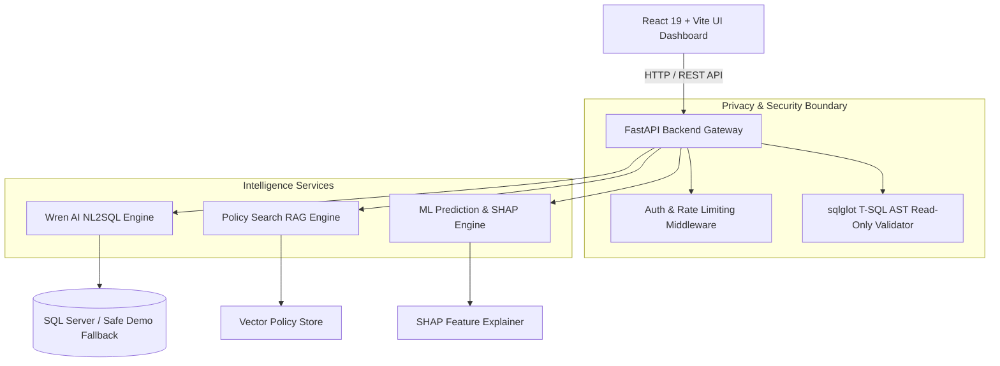

# EduQuery AI

**A Prompt-Based Intelligent Analytics and Prediction Engine for Multi-Campus Academic Databases**

[](https://www.python.org/)
[](https://fastapi.tiangolo.com/)
[](https://react.dev/)
[](https://vitejs.dev/)
[](https://eduquery-ai.vercel.app)

EduQuery AI empowers educational leaders, principals, and administrative teams to query complex institutional databases using natural language, receive explainable data visualizations, search policy documents via RAG, and review advisory student academic risk predictions—without exposing confidential student PII.

---

## Key Features

- **Multi-Engine Query Intelligence**:
  - **Wren AI NL2SQL Synthesizer**: Translates natural language questions into valid T-SQL queries over 68 governed database definitions across 20 campuses.
  - **Policy Search RAG**: Vector similarity search over official institutional policy documents (leave, attendance, admission, medical, day scholars) with exact clause citations.
  - **Multi-Tier ML Academic Risk Engine**: AutoGluon/TabPFN ML models providing student risk scores, teacher outcome forecasting, and subject bottleneck analysis backed by SHAP (SHapley Additive exPlanations).

- **Enterprise Security & Privacy Boundary**:
  - **Read-Only AST Validation**: AST-based query safety parser using `sqlglot` to block `INSERT`, `UPDATE`, `DELETE`, `DROP`, or system table execution.
  - **Local PII Redaction**: Automatic tokenization of student identifiers prior to processing.
  - **Safe Fallback Demo Mode**: Seamless offline demonstration mode using a de-identified, schema-matched dataset (`demo_fallback.json`).

- **Modern Web Dashboard**:
  - React 19 + Vite frontend appshell with 20-campus selector, multi-engine switching, interactive charts (Recharts), and responsive session navigation.

---

## System Architecture



---

## 1-Command Local Quickstart

### Prerequisites
- **Python**: 3.11+ (managed via `uv` or `pip`)
- **Node.js**: 18+ and `npm`

### 1. Clone & Set Up Backend
```bash
# Clone the repository
git clone https://github.com/<your-username>/EduQuery-AI.git
cd EduQuery-AI

# Install Python dependencies
uv sync --extra dev

# Run Backend API Server (starts on http://127.0.0.1:8000)
uv run uvicorn services.api.main:app --reload --port 8000
```

### 2. Set Up & Launch Frontend UI
```bash
# Navigate to web app directory
cd apps/web

# Install frontend dependencies
npm install

# Start Vite Development Server (starts on http://localhost:5173)
npm run dev
```

Open `http://localhost:5173` in your browser to try the application live!

---

### Option B: Run via Docker (1-Command Container Launch)
If you have Docker installed, you can build and start the containerized backend & frontend in 1 command:

```bash
docker-compose up --build
```
Access the application at `http://localhost:8000`.

---

## Running Automated Tests

Run the complete backend test suite (113 passing tests):
```bash
uv run python -m pytest tests/unit -v
```

---

## Repository Structure

| Directory / File | Description |
|---|---|
| `apps/web/` | React 19 + Vite frontend dashboard application |
| `services/api/` | FastAPI REST API endpoints, auth middleware, and AST validation |
| `services/query/` | Wren AI NL2SQL engine and semantic glossary definitions |
| `services/prediction/` | Multi-tier ML risk prediction and SHAP explainer services |
| `data/semantic/` | Governed semantic glossary, gold prompts, and demo fallback dataset |
| `docs/09-rag-data-md/` | Institutional policy markdown documents for RAG search |
| `ml/` | ML model definitions, AutoGluon scripts, and MLflow pipeline |
| `tests/` | Unit, integration, and security test suites |
| `Dockerfile` | Production multi-stage Docker build specification |
| `docker-compose.yml` | 1-command container orchestration config |

---

## Author & Credits

Designed, architected, and engineered by **Muhammad Zain**.
